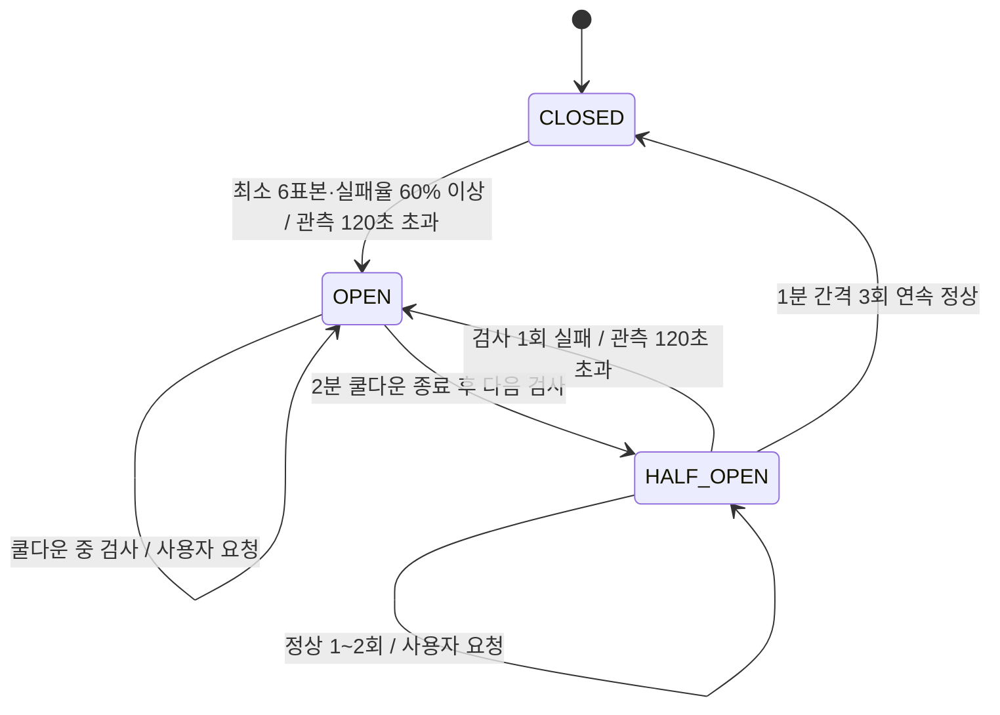

# 0001 홈서버의 분 단위 슬라이딩 윈도우와 서킷 브레이커

- 상태: 채택 — 로컬 검증 완료, 운영 배포·장애 전환은 미검증
- 날짜: 2026-11-05

## 배경

홈서버를 우선 사용하고 장애 시 Cloud Run으로 전환한다. 사용자는 홈서버 장애부터 백업에서 응답을 받을 때까지 10분을 운영 목표로 정했다. Cloudflare Workers는 요청 라우터이며 Durable Object는 헬스 이력과 회로를 소유한다. 관련 구현·설정의 소유 저장소는 `JECT-Study/Ziper-5th-Infra`이다. 애플리케이션의 `/readyz` 계약은 `Ziper-5th-Server`에 남는다.

기존 Server 저장소의 [ADR 0004](https://github.com/JECT-Study/Ziper-5th-Server/blob/codex/production-monitoring-20261105/docs/adr/0004-deployment-and-failover.md)는 미구현 계획으로 10초 검사·연속 실패를 사용했다. 이 ADR이 분 단위 표본·상태 전이·라우팅 정책을 새로 정의한다. 기존 배포 파이프라인 전체를 이 변경에서 구현 완료했다고 간주하지 않는다.

사용자 요청을 표본으로 세면 한 번의 장애가 동시 접속 수만큼 확대된다. 예를 들어 같은 분의 1,000개 실패 요청으로 10분 윈도우가 즉시 채워지면 시간 기반 정책이 깨진다.

## 결정

### 표본과 실패율

| 항목 | 값과 의미 |
| --- | --- |
| 검사 주체 | 홈 오리진당 하나의 SQLite Durable Object, 고정 이름 `ziper-home-v1` |
| 검사 주기 | DO alarm, UTC epoch 기준 60초 슬롯 |
| 표본 | Worker 경로를 우회한 홈 오리진의 `GET /readyz` 결과만 사용 |
| 정상 | 리다이렉트를 따르지 않은 HTTP 200 |
| 실패 | 200 외 상태, 네트워크 오류, 5초 초과, 검사 설정 오류 |
| 윈도우 | 현재 슬롯 포함 최근 10개 분 슬롯 안에서 완료한 검사, 최대 10개 |
| 최소 표본 | 6개; 초기 6개 미만은 실패율로 OPEN하지 않음 |
| 전환 임계값 | 완료 표본 중 실패율 **60% 이상** (`failures * 100 >= samples * 60`) |
| 관측 중단 | 마지막 완료 관측 또는 최초 생성 후 120초 초과 시 OPEN |
| 중복 | 검사 전에 분 슬롯을 영속 예약. 같은 분의 재시도는 새 표본을 만들지 않음 |
| 누락 | 과거 분을 따라잡기 위해 여러 번 검사하거나 가짜 표본을 채우지 않음. 관측 중단 규칙으로 처리 |

사용자 요청의 성공·4xx·5xx·타임아웃은 이 윈도우에 추가하지 않는다. 1,000개 동시 요청이 실패해도 그 분의 전용 검사는 최대 1개다. 트래픽 실패율은 Sentry 등 별도 지표로 다룬다. 과부하로 readiness가 여러 분 실패하는 경우에는 실제 가용성 저하로 간주한다.

초기 표본 6개 중 실패 4개면 66.7%이므로 OPEN할 수 있다. 충분히 채운 10개 표본에서는 실패 6개가 필요하다. 초기와 정상 운영의 분모가 다르다는 점을 명시한다. 짧은 순간 오류를 5초 안에서 재시도해 지우지 않는다.

### 상태 전이

CLOSED에서는 홈서버에 사용자 요청을 전달한다. OPEN과 HALF_OPEN에서는 홈서버에 사용자 요청을 전달하지 않는다. HALF_OPEN의 제한된 시험 요청은 DO의 전용 readiness 검사뿐이다. 사용자 요청을 시험 요청으로 사용하지 않는다. 성공 사이 분이 누락되거나 예약 후 완료하지 못한 검사가 있으면 연속 성공 수를 0부터 다시 센다.

OPEN은 과거 실패 표본이 오래됐다는 이유만으로 CLOSED가 되지 않는다. 백업의 정상 여부와도 독립적이다. 2분 이후 HALF_OPEN에서 3회 연속 정상일 때만 CLOSED가 되며 이전 윈도우를 비운다. 새 세대 번호로 이전 검사 응답을 차단한다. 이미 홈으로 전달 중인 요청을 OPEN 순간 취소하거나 다른 오리진으로 옮기지는 않는다.

### 상태 저장과 동시성

전 세계 Worker 진입점이 같은 DO 이름을 사용한다. 회로·슬롯·세대 번호는 SQLite 단일 상태 행에 저장하고, 관련 읽기·쓰기는 `transactionSync`로 처리한다. 외부 네트워크 I/O는 트랜잭션과 `blockConcurrencyWhile` 밖에서 수행한다. 여러 애플리케이션의 회로를 한 객체에 합치지 않는다.

alarm은 다음 분 예약을 먼저 저장하고 현재 분의 probe를 예약한다. 예약 후 중단된 분을 재시도 표본으로 중복 반영하지 않는다. 완료 시 세대 번호·슬롯·이미 반영 여부를 검사한다. 재시작 후 SQLite와 예약한 alarm을 복원한다. 생성자에서 기존 alarm을 덮어쓰지 않는다. 첫 요청이 DO를 생성하고 다음 분부터 주기 검사가 시작된다. 배포 후 공개 readiness 확인이 이 시작을 겸한다.

상태 캐시를 각 PoP에 두지 않고 요청마다 DO에서 라우팅 결정을 받는다. DO 장애·용량 초과·파싱 실패 시 503을 반환하며 홈으로 우회하지 않는다. 이 선택은 회로의 일관성을 우선하므로 Cloudflare 장애 시 홈서버가 살아 있어도 서비스가 중단될 수 있다. `fail-open`을 자동으로 켜지 않는다.

### 오리진과 요청 전달

홈 전용 HTTPS 호스트는 Worker route와 달라야 하며, Tunnel과 Cloudflare Access의 Service Auth 정책으로 보호한다. Worker의 Access client ID·secret만 허용한다. 브라우저 로그인 정책이나 공개 우회 호스트를 사용하지 않는다. `/readyz`는 홈서버의 실제 DB 준비 상태를 포함한 애플리케이션 상태를 반환해야 한다.

사용자의 `Authorization`, 본문, 경로·쿼리는 원래 요청에 맞게 전달한다. 클라이언트가 보낸 오리진 접근 인증 헤더는 제거하고 서버 자격으로 교체한다. 리다이렉트는 따라가지 않는다. 요청 본문과 응답은 스트림으로 전달한다. 모든 메서드를 한 번만 전달하며, 결과가 불명확한 쓰기를 백업에서 자동 재시도하지 않는다. 오리진 응답 5xx도 그대로 전달하고 회로 표본에는 더하지 않는다. 연결 오류·라우터 오류에는 정적인 503과 `no-store`를 반환한다. 30초 요청 타임아웃은 응답 헤더 대기와 fetch에 적용하며, 이미 전달한 응답 본문의 전체 수신 시간을 보장하지 않는다.

Cloud Run은 실제 서비스 `https://*.run.app` URL을 사용한다. private IAM을 유지하고 전용 서비스 계정에 해당 서비스의 `roles/run.invoker`만 부여한다. 사용자 JWT를 보존하려고 Google ID token은 `X-Serverless-Authorization`에 넣는다. 이 구현은 외부 Worker용 서비스 계정 키를 secret으로 받아 서명 JWT를 Google에 교환한다. ID token은 audience·만료 시간을 확인해 DO에 캐시한다. 키와 토큰은 로그·공개 API에 출력하지 않는다. 키의 장기 보관·회전 부담이 있으므로 WIF 전환은 별도 ADR에서 설계하며, 이를 이미 구현했다고 기록하지 않는다.

토큰 갱신은 SQLite의 10초 소유권 lease로 한 번에 하나만 실행한다. 갱신 중 다른 요청은 Google 인증을 중복 호출하지 않고 503을 반환한다. 성공한 캐시는 이후 요청이 재사용한다. 비정상 중단 시 lease 만료로 갱신을 재개할 수 있다. 이 처리 역시 사용자 요청을 재전송하지 않으며, 백업으로 처음 전환할 때 일부 요청의 일시적 실패를 허용한다.

백업을 활성화하면 OPEN·HALF_OPEN에서 Cloud Run에 직접 전달한다. 평상시 Cloud Run 헬스 체크로 백업을 계속 깨우지 않는다. 인증·연결 실패 시 503을 반환한다. 백업이 비활성화되어도 홈 회로는 정상적으로 OPEN하며 사용자 응답은 503이다.

### 10분 목표와 비용

10개 정상 표본이 채워진 상태에서 연속 장애라면 6번째 실패 관측에 OPEN한다. 검사 주기·타임아웃을 합친 감지는 통상 최대 약 6분 5초다. 이후 백업 기동·응답에 2분, 나머지는 지연 여유로 배정한다. 이는 알람·네트워크·백업이 정상적으로 동작할 때의 **설계 예산**이며 제공업체 SLA나 검증한 최악 지연이 아니다. 간헐 오류는 임계값 아래면 계속 홈으로 보낸다.

10분 안에 백업에서 성공 응답을 받는다는 판정은 실제 홈 장애 주입부터 최초 백업 성공 응답까지 측정해야 한다. 현재 백업 비활성 구성으로는 이 판정을 통과할 수 없다. cold start 중 개별 요청은 30초 제한으로 실패할 수 있으며 자동 재전송하지 않는다.

기본값은 Workers Free + SQLite DO이며 `BACKUP_ENABLED=false`이다. Cloud Run·청구 계정·유료 플랜은 이 변경에서 생성하지 않는다. 백업 활성화 전에 실제 비용 조건과 운영 권한을 확정한다. 무료 한도는 계정 전체 사용량을 함께 계산한다. 일일 기본 alarm 1,440회 외에 사용자 요청마다 DO RPC가 1회 추가된다. 지속적인 과부하·무료 한도 초과는 503으로 이어질 수 있다. 0원 조건과 무제한 가용성을 동시에 보장하지 않는다.

인프라 main CI가 성공한 커밋만 GitHub Actions에서 수동으로 배포한다. PR·main push는 검사만 수행한다. 배포 workflow는 main 참조와 같은 SHA의 성공한 push CI를 확인하며 production 환경의 secrets를 사용한다.

## 대안

- **사용자 요청 실패율:** 트래픽에 비례해 한 장애가 여러 표본으로 증폭되므로 채택하지 않는다.
- **10초 검사·연속 실패 3회:** 종전 계획이다. 분 단위 윈도우와 10분 장애 허용 요구에 맞춰 변경한다.
- **Cron과 DO alarm을 함께 사용:** 독립 검사 주체가 중복 표본을 만들고 운용 복잡도가 커진다. DO alarm 하나로 시작한다. 알람 복구용 별도 watchdog이 필요하면 역할과 중복 정책을 새로 결정한다.
- **PoP별 상태 캐시·DO 장애 시 홈 우회:** 오래된 CLOSED 상태가 OPEN 이후에도 홈으로 보내므로 초기 구현에서 제외한다.
- **HALF_OPEN에서 사용자 일부로 시험:** 쓰기 결과가 불분명해질 수 있고 요청 수가 관측을 바꾸므로 readiness만 사용한다.
- **Cloud Run 상시 예열·공개 IAM:** 비용과 접근 경계를 약화하므로 제외한다.

## 영향과 한계

한 DO에 라우팅 결정을 집중하므로 사용자 요청당 추가 왕복과 단일 회로의 처리량 한계가 생긴다. 이번 동시성 검사는 표본 중복 여부를 검증하며 실제 1,000명 수용량·지연을 측정한 부하 시험이 아니다.

readiness가 놓치는 업무 API 장애, 실제 DB 병목, Cloudflare에서 홈으로 가는 경로 장애의 오탐, 공용 Supabase 장애로 양쪽이 함께 실패하는 경우가 남는다. HALF_OPEN은 readiness 회복을 확인할 뿐 전체 업무 흐름의 회복을 보증하지 않는다. Cloud Run cold start, IAM 오류, 무료 한도, 키 회전, DNS/Tunnel/Access 설정, 배포 중 다중 버전 호환성을 운영에서 추가 검증한다.

정책 판정과 검증 범위는 [검증 문서](../verification.md), 필요한 설정과 재개 절차는 [운영 문서](../operations.md)에 기록한다.

공식 근거(2026-11-05 확인): [DO alarms](https://developers.cloudflare.com/durable-objects/api/alarms/), [SQLite transactionSync](https://developers.cloudflare.com/durable-objects/api/sqlite-storage-api/), [DO Free 요금·제한](https://developers.cloudflare.com/durable-objects/platform/pricing/), [Cloud Run 인증](https://docs.cloud.google.com/run/docs/authenticating/service-to-service).
